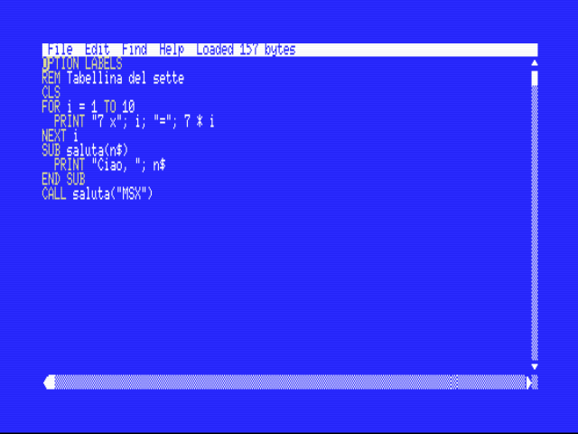
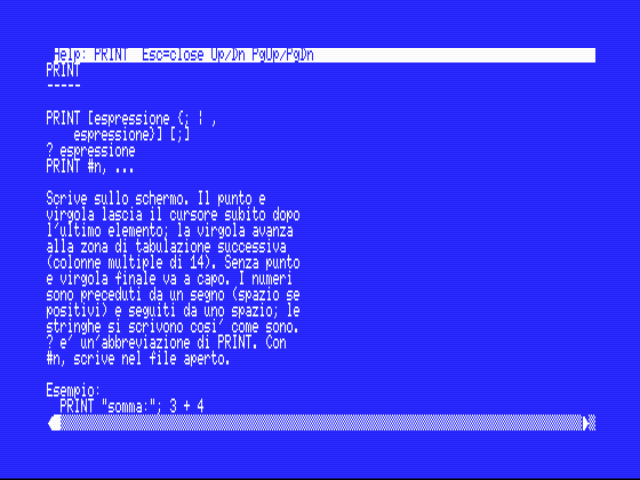
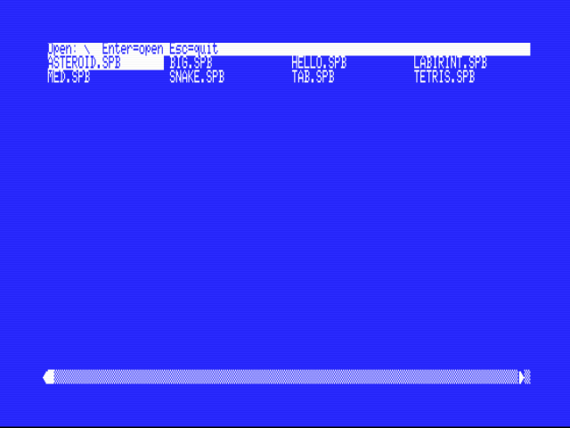
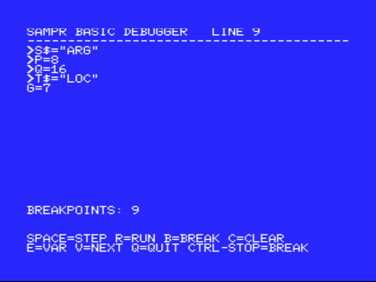

# SamPr Basic

**Un ambiente di sviluppo BASIC completo che gira sull'MSX: editor a schermo intero, compilatore che produce vero codice Z80, assembler in linea e debugger — senza bisogno di un PC.**

Scrivi il programma, premi **F5**: in pochi secondi il programma gira alla velocità della macchina. Nato per i videogiochi (grafica bitmap, sprite, suono a 3 voci, joystick, mapper, cartucce), funziona su **MSX1** (editor a 40 colonne) e **MSX2** (80 colonne) con **MSX-DOS 1 e 2**.

*SamPr Basic 1.0 — © 2026 Fausto Pracek*

| Editor con parole chiave colorate | Aiuto in linea (F6 / F7) |
|:--:|:--:|
|  |  |

| Apertura file con cartelle | Debugger con variabili locali |
|:--:|:--:|
|  |  |

## Perché

- **Compilatore vero, sull'MSX.** Ogni istruzione BASIC diventa codice macchina: niente interprete. Il compilatore stesso è un programma Z80 di 15 KB che gira sotto MSX-DOS.
- **Un linguaggio moderno ma piccolo.** Interi a 16 bit e stringhe; `SUB`/`FUNCTION` con parametri, variabili locali e ricorsione; `IF/ELSEIF`, `SELECT CASE`, `DO/LOOP`; etichette **o** numeri di riga (a scelta con `OPTION`); maiuscole e minuscole equivalenti. Niente virgola mobile: per un gioco costerebbe solo velocità e memoria.
- **Tutto ciò che serve a un gioco è un'istruzione:** `SCREEN 5-8` (anche 10-12), `PSET/LINE/CIRCLE/PAINT/DRAW`, `COPY`, pagine e scroll hardware, `PALETTE`, sprite 8x8/16x16 con colori per riga, `PLAY` MML a tre voci, `SOUND`, `STICK/STRIG`, accesso diretto alla VRAM a 17 bit.
- **Assembler Z80 in linea** con `__ASM … __ENDASM` (tutte le istruzioni documentate, variabili e etichette BASIC visibili dal blocco).
- **Debugger passo-passo** (`OPTION DEBUG`): breakpoint, variabili globali e **locali/parametri** (`>`), comando **E** per interrogare qualsiasi variabile (`V(3)`, `N$`…).
- **Tre uscite con una sola opzione** (`OPTION TARGET`), senza impostazioni in conflitto.
- **Cartucce ROM da 16 KB a 2 MB** (ASCII8, ASCII16, Konami, SCC) con il codice su più **segmenti**, uno per file, e segmenti già compilati `.BIN` per assembler e dati.
- **File su disco** (testo e ad accesso casuale), **mapper RAM**, `BLOAD/BSAVE`, cartelle di MSX-DOS 2.
- **Manuale PDF** di oltre 40 pagine e aiuto in linea con tutte le istruzioni.

## Esempio

```basic
OPTION LABELS
CLS
FOR i = 1 TO 10
  PRINT "7 x"; i; "="; 7 * i
NEXT i
CALL saluta("MSX")

SUB saluta(n$)
  PRINT "Ciao, "; n$
END SUB
```

## Avvio rapido

1. Copia sul disco MSX-DOS i file della cartella [`dist/`](dist): `SAMPRBAS.COM` (editor), `QBC.COM` (compilatore), `RT.BIN` (runtime) e, se servono, `RTD.BIN` (debug), `QASM.OVL` (assembler), `QBCR.COM`+`RTROM.BIN` (cartucce), `QBCB.COM`+`RTBIN.BIN` (BIN), `HELP.TXT`+`HELP.IDX` (aiuto).
2. Avvia `SAMPRBAS PROVA` (apre `PROVA.SPB`, o lo crea con quel nome). Con MSX-DOS 2 si può dare un percorso: `SAMPRBAS \GIOCHI\PROVA`.
3. Scrivi il programma e premi **F5**. Alla fine del programma l'editor si riapre; se c'è un errore il cursore è sulla riga sbagliata.

Per provare tutto sul PC con [openMSX](https://openmsx.org): `avvia_nms8250.bat` (MSX2, 80 colonne) o `avvia_hb75p.bat` (Sony HB-75P, MSX1, 40 colonne) montano il disco di prova [`disco_prova/`](disco_prova) (con i programmi d'esempio `.SPB`; servono anche `MSXDOS.SYS` e `COMMAND.COM`, che non sono inclusi).

## Che cosa produce: `OPTION TARGET`

| Valore | Risultato |
|---|---|
| `DOS` (predefinito) | `NOME.COM` per MSX-DOS, con i file su disco |
| `BIN` | `NOME.BIN` per MSX-BASIC: `CLEAR 200,&H83FF` e `BLOAD "NOME.BIN",R`, senza DOS |
| `ROM_16`, `ROM_32` | cartuccia semplice da 16 o 32 KB |
| `ROM_ASCII8`, `ROM_ASCII16` | cartuccia a banchi ASCII |
| `ROM_KONAMI`, `ROM_KONAMISCC` | cartuccia a banchi Konami (senza o con SCC) |

### Cartucce su più file

Un programma grande si scrive in un file per segmento, `NOME000.SPB` (principale, con le `OPTION`) e `NOME001.SPB`, `NOME002.SPB`… (5 caratteri + 3 cifre). Il compilatore li legge tutti e li collega in un'unica `NOME.ROM`; si preme F5 da qualunque file. Un `NOMEnnn.BIN` è un segmento già compilato (assembler, sprite, font) e viene inserito così com'è. In editor, **File ▸ Segment… (F8)** salva il file corrente e passa al segmento indicato.

## Editor

Menu a tendina da tastiera (**Esc**, **F1–F4**) e col mouse; selezione, copia/incolla, annulla/ripeti, cerca/sostituisci; finestra di apertura con le cartelle (DOS 2) e salto con la lettera iniziale; **F5** compila ed esegue; **F6** aiuto sulla parola sotto il cursore; **F7** indice dell'aiuto; **F8** cambia segmento. I sorgenti hanno estensione **`.SPB`** (*SamPr Basic*); in *Save As* si digitano al massimo 8 caratteri.

## Documentazione

- **[Manuale d'uso e riferimento (PDF)](dist/SamPrBasic-Manuale.pdf)**: copertina, installazione, editor, linguaggio, ogni istruzione con sintassi ed esempio, assembler, debugger, cartucce, BIN, errori e limiti.
- Aiuto in linea nell'editor (menu Help).
- Dettagli di realizzazione: [`onmsx/README.md`](onmsx/README.md) (compilatore e runtime, stadi 1–27), [`editor/README.md`](editor/README.md) (editor), [`DESIGN-ONMSX.md`](DESIGN-ONMSX.md) (progetto).
- Il PDF e `HELP.TXT`/`HELP.IDX` si generano dalla stessa sorgente: [`doc/`](doc) (`gen_pdf.py`, `gen_help.py`).

## Compatibilità e collaudo

MSX1 e MSX2/2+/turbo R; MSX-DOS 1.03 e 2 (Nextor). Collaudato su [openMSX](https://openmsx.org) con Philips NMS 8250, Sony HB-75P (+ interfaccia disco), Panasonic FS-A1ST: centinaia di controlli automatici sugli schermi, i pixel della VRAM, i registri del PSG e i byte delle ROM prodotte. **Non è stato provato su un MSX reale.**

Suite principali (richiedono openMSX, [sjasmplus](https://github.com/z00m128/sjasmplus) e Python 3 con `reportlab`/`Pillow` per i documenti):

```
cd onmsx  && python qtest.py        # compilatore (programmi DOS)
cd onmsx  && python rtest.py        # cartucce ROM, tutti i mapper
cd onmsx  && python mtest.py        # cartucce su più file, segmenti .BIN
cd onmsx  && python btest.py        # programmi BIN (compila sotto DOS, esegue da MSX-BASIC)
cd onmsx  && python gtest.py        # grafica, sprite, palette
cd editor && python etest.py        # editor (e molte altre: esel, emenu, ecom, ehelp, ebrowse, eseg, edir…)
```

## Struttura

| Cartella | Contenuto |
|---|---|
| [`onmsx/`](onmsx) | compilatore (`qbc.asm`), runtime (`rtcom.asm` e moduli), assembler in linea, debugger, test |
| [`editor/`](editor) | editor (`editor.asm`, `fileio.asm`), aiuto, finestra dei file, test |
| [`doc/`](doc) | manuale PDF, aiuto in linea, schermate, generatori |
| [`dist/`](dist), [`disco_prova/`](disco_prova) | file da copiare sul disco MSX, programmi d'esempio |

## Limiti noti

Solo interi a 16 bit (niente virgola mobile; l'implementazione sperimentale è nel tag git `float-archive`). Sorgente di circa 12,5 KB per file (15 KB per le cartucce), programma compilato fino a 16 KB (le cartucce hanno più segmenti). I programmi BIN non hanno file, mapper RAM e debugger.

---

*Il progetto è nato come prototipo cross Python → Z80: il vecchio README è in [`doc/PROTOTIPO-PYTHON.md`](doc/PROTOTIPO-PYTHON.md).*
