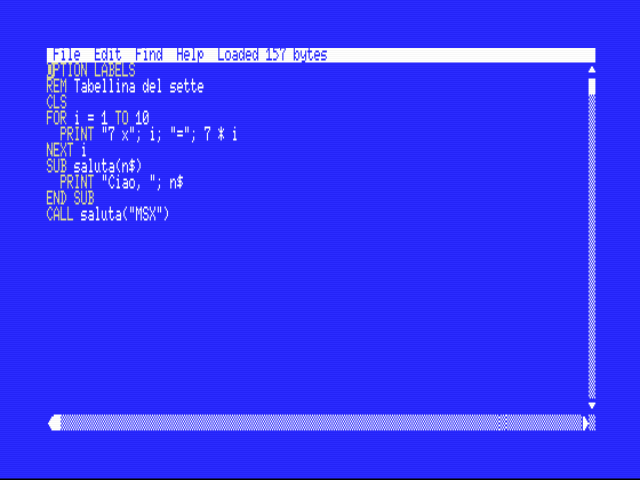
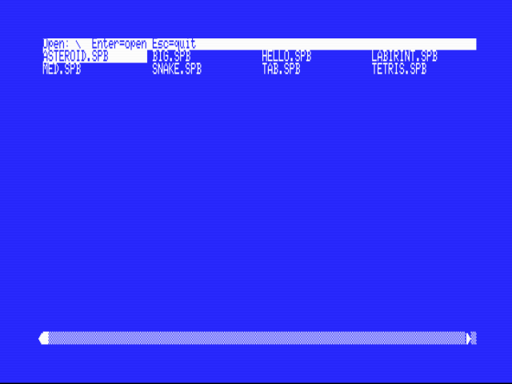
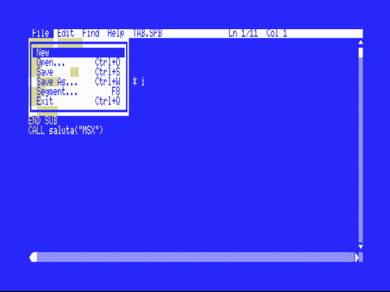
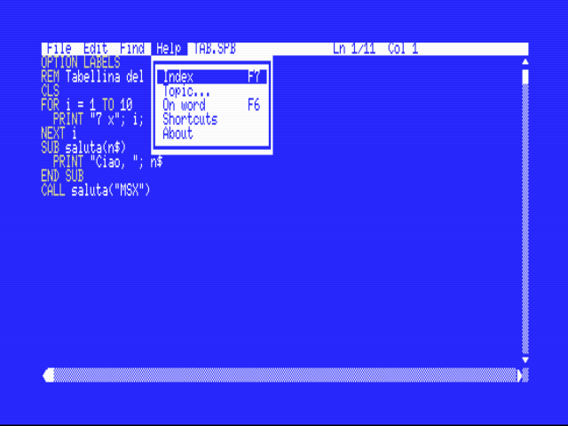
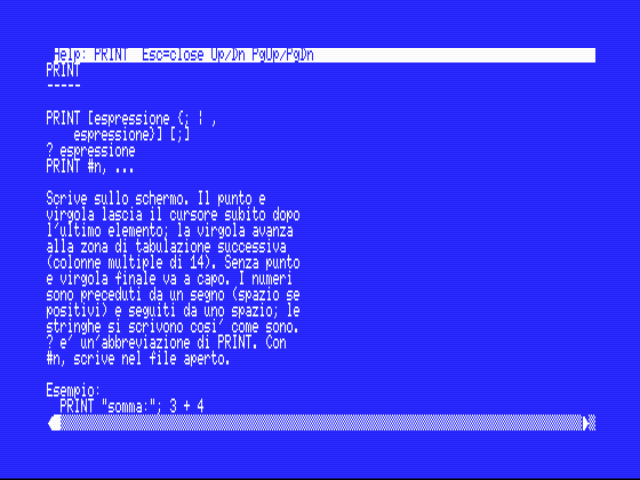
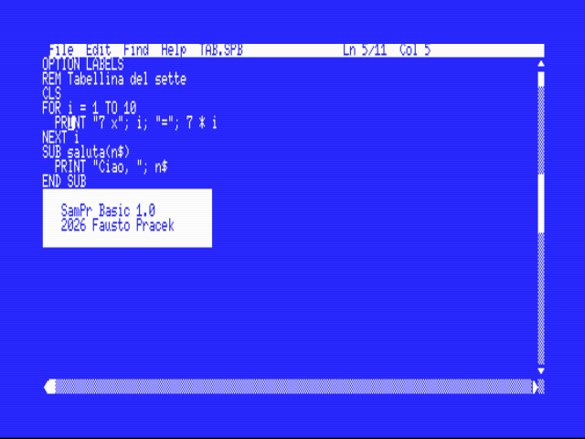
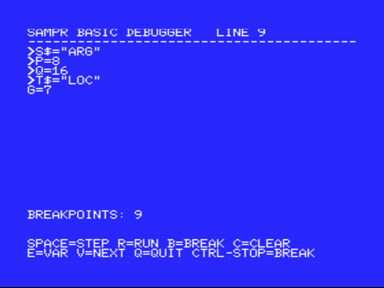

# SamPr Basic 1.0 - User manual and reference

> This file is generated from the same sources as the PDF manual and the on-MSX help (`doc/chapters.py`, `doc/topics_core.py`, `doc/topics_hw.py`, `doc/topics_guide.py`) with `python doc/gen_md.py`. Corrections and improvements are welcome as pull requests or issues: please edit those source files (the text is plain Python strings) or send the change on this file and it will be ported.

## Contents

- [Introduction](#introduction)
- [Installation and start](#installation-and-start)
- [The editor](#the-editor)
- [The language at a glance](#the-language-at-a-glance)
- [Inline assembler](#inline-assembler)
- [The debugger](#the-debugger)
- [ROM cartridges, segments and mappers](#rom-cartridges-segments-and-mappers)
- [Programs for MSX-BASIC (BIN)](#programs-for-msx-basic-bin)
- [Working directory (MSX-DOS 2)](#working-directory-msx-dos-2)
- [VS Code extension](#vs-code-extension)
- [MSX1 and MSX2](#msx1-and-msx2)
- [Language reference](#language-reference)
  - [Program structure](#program-structure)
  - [Flow control](#flow-control)
  - [Data and arrays](#data-and-arrays)
  - [Text and keyboard](#text-and-keyboard)
  - [Numeric and string functions](#numeric-and-string-functions)
  - [Screen and graphics](#screen-and-graphics)
  - [Sprites](#sprites)
  - [Sound](#sound)
  - [Disk files](#disk-files)
  - [ROM cartridges, segments and mappers](#rom-cartridges-segments-and-mappers-1)
  - [Options (OPTION)](#options-option)
- [Errors and limits](#errors-and-limits)
- [Keyword index](#keyword-index)

## Introduction

**SamPr Basic** is a complete development environment that runs **directly on an MSX computer**: a full-screen editor, a BASIC compiler that produces real Z80 machine code and a debugger, all without needing a PC. You write the program, press **F5** and after a few seconds the program runs at the speed of the machine.

### What it offers

- **A real compiler**: every BASIC statement becomes Z80 code; the result is a .COM file (MSX-DOS) or a .ROM cartridge.
- **Editor** with pull-down menus (also from the keyboard), mouse, selection, copy/paste, undo/redo, find and replace, keyword colors.
- **Structured language**: SUB and FUNCTION with parameters, local variables and recursion; IF/ELSEIF, SELECT CASE, DO/LOOP; labels or line numbers.
- **Built for games**: MSX2 bitmap graphics, sprites, direct VRAM access, scrolling, joystick, three-voice sound with the MML language.
- **Inline Z80 assembler** with `__ASM ... __ENDASM` for the critical parts.
- Step-by-step **debugger** with breakpoints and variables (`OPTION DEBUG`).
- `OPTION BREAK`: CTRL+STOP stops a program started from the editor and returns to it.
- **ROM cartridges** from 16 KB to 2 MB (ASCII8, ASCII16, KONAMI, SCC) with code spread over several segments and embedded data.
- **Disk files**, text and random access; **RAM mapper** for large amounts of data; BLOAD/BSAVE.
- **MSX1 and MSX2**: on MSX1 the editor works in 40 columns, on MSX2 in 80, chosen automatically.
- **Online help** (F6 on the word under the cursor, F7 for the index) with all statements documented.

### Philosophy

The language is a modern but deliberately small BASIC: 16-bit integers and strings, no floating-point numbers (which for video games would cost speed and memory without any benefit). Everything a game needs — sprites, scrolling, sound, joystick, mapper — is a statement or a function. Upper and lower case are equivalent everywhere.

## Installation and start

You need an MSX (MSX1 with at least 64 KB of RAM, or MSX2) with a disk drive and MSX-DOS 1 or 2 (or Nextor). Copy the following files to the disk:

| File | Purpose |
|---|---|
| SAMPRBAS.COM | The editor: start it with `SAMPRBAS NAME.SPB` |
| QBC.COM | The compiler (launched by F5) |
| RT.BIN | The runtime of the compiled program |
| RTD.BIN | Runtime with debugger (for OPTION DEBUG) |
| QASM.OVL | The inline assembler (for __ASM) |
| QBCR.COM, RTROM.BIN, RTROMD.BIN | To produce ROM cartridges |
| QBCB.COM, RTBIN.BIN | To produce BIN programs for MSX-BASIC |
| HELP.TXT, HELP.IDX | The online help (optional) |

Start the editor with `SAMPRBAS` (new program) or `SAMPRBAS TEST.SPB`. On MSX1 DOS asks for the date at startup: press Enter. On a PC you can try everything with the openMSX emulator: the project folder contains `start_nms8250.bat` (MSX2, 80 columns) and `start_hb75p.bat` (Sony HB-75P MSX1, 40 columns), which mount the test disk.

### Program files: the .SPB extension

Source files have the extension **.SPB** (SamPr Basic). When you start `SAMPRBAS TEST` the editor opens TEST.SPB if it exists; otherwise it starts with a new file that already has that name (the .SPB extension is added automatically if missing). In **Save As** you type at most 8 characters and the editor adds .SPB. The compiled program gets the same name with extension .COM (or .ROM for cartridges).

### First program

```basic
PRINT "Hello MSX!"
FOR i = 1 TO 5
  PRINT i; " x 2 ="; i * 2
NEXT i
```

Type the program in the editor and press **F5**. At the end the run waits for a key and returns to the editor (a NAME.COM that you launch yourself from the DOS prompt returns to the DOS prompt instead). If there is an error, the editor reopens with the cursor on the wrong line and the message in the title bar.

## The editor

The editor has a menu bar at the top (**File Edit Find Help Run**), the text area with line numbers, the scroll bar and a status line with cursor position and file name. It works with the keyboard and with the mouse (if present).



### Keyboard menus

| Key | Action |
|---|---|
| Esc | Opens the File menu; closes an open menu |
| F1 F2 F3 F4 | Open File, Edit, Find, Help |
| Left / Right | With a menu open: switches to the adjacent menu |
| Up / Down, Enter | Choose the item |
| Highlighted letter | Activates the item (e.g. N = New, O = Open) |
| F5 | Compiles and runs the program |
| F6 | Help on the word under the cursor |
| F7 | Help index |

### Editing text

| Key | Action |
|---|---|
| Arrows, Home, End, PgUp, PgDn | Cursor movement |
| Shift + arrows | Selection |
| Ctrl+C / Ctrl+X / Ctrl+V | Copy, cut, paste |
| Ctrl+Z / Ctrl+Y | Undo / redo |
| Ctrl+F / Ctrl+G / Ctrl+T | Find / find again / replace |
| Ctrl+S / Ctrl+W | Save / save as |
| Ctrl+O / Ctrl+Q | Open / quit |

BASIC keywords are highlighted in yellow (MSX2 only). Long lines scroll horizontally. When saving, the editor overwrites the file in place and does not save if the text has not changed; F5 without changes reruns the program without recompiling.

### Opening a file: the file window

File > Open... (Ctrl+O) shows a window with all the **.SPB** files of the current directory, in alphabetical order. With MSX-DOS 2 the **folders** also appear (in square brackets, `[GAMES]`, and `[..]` to go up) and you can navigate among them; the current path is in the title. With MSX-DOS 1 there are no folders and only files are shown.

| Key | Action |
|---|---|
| Arrows | Move the selection (two columns on MSX1, four on MSX2) |
| PgUp / PgDn, Home | Previous / next page, first entry |
| A letter | Jumps to the first entry starting with that letter |
| Enter | Opens the file or enters the folder |
| Esc | Closes the window without opening anything |



### Saving with a name

File > Save As... (Ctrl+W) asks for the name: **at most 8 characters**; the .SPB extension is added by the editor (if you type an extension it is replaced). F5 on an unnamed program also asks for the name in the same way.



### Segment projects: File > Segment (F8)

For segmented cartridges (see the chapter on cartridges) each segment is a file **NAME000.SPB**, **NAME001.SPB**, ... (5 characters plus 3 digits). File > Segment... (key **F8**) asks for the segment number, even without leading zeros (`7` is the same as 007): the editor **saves the current file**, then looks for and opens the file with that number in the same directory. If the file does not exist, or is a **.BIN** segment (which cannot be opened), the editor says so with a message and the active file stays the previous one. The item cannot be used if the current file has no name yet or if the name is not 5 characters plus 3 digits: in that case you are not working with segments. A new segment is created with File > New and Save As... (NAME005, ...).

### The Help menu

- **Index (F7)**: the list of all topics.
- **Topic...**: asks for a topic name (PRINT, ASM, DEBUG, OPTION...).
- **On word (F6)**: documents the word under the cursor.
- **Shortcuts**: summary of the keys.
- **About**: a centered window with the menu frame, *SamPr Basic 1.0 — 2026 Fausto Pracek* and the OK button; it closes with Enter, Esc or a click on OK.







In the help viewer: arrows and PgUp/PgDn scroll, Esc closes. The text comes from the files HELP.TXT and HELP.IDX in the current directory: HELP.TXT is a plain text file and can be edited; HELP.IDX is the index (name, position, length) regenerated by the `doc/gen_help.py` tool.

## The language at a glance

A program is a sequence of statements, one per line (or several, separated by `:`). Comments start with `REM` or with an apostrophe.

### Types and variables

Signed 16-bit integers and strings up to 255 characters. Variables do not need to be declared: they are 0 or the empty string. Arrays are declared with DIM.

```basic
n = 12 : m = &HFF : b = &B101
name$ = "Sam"
DIM v(10), t$(5)
v(3) = n * 2
t$(1) = name$ + "!"
```

### Control structures

```basic
IF n > 10 THEN PRINT "big" ELSE PRINT "small"

FOR i = 1 TO 10 STEP 2 : PRINT i; : NEXT i

SELECT CASE n
  CASE 1 TO 5 : PRINT "low"
  CASE ELSE : PRINT "high"
END SELECT
```

### Routines

```basic
FUNCTION fact(n)
  IF n <= 1 THEN
    fact = 1
  ELSE
    fact = n * fact(n - 1)
  END IF
END FUNCTION

PRINT fact(7)
```

### Labels or numbers

The program can use labels (`start:`) or line numbers; the OPTION directive chooses the mode: NUMBERED, LABELS or MIXED (default).

## Inline assembler

For the parts that must be very fast you can write Z80 assembler directly, between the lines **__ASM** and **__ENDASM**. The compiler loads a small assembler (QASM.OVL) that translates the block into machine code inserted into the program.

```basic
__ASM
  ld hl,(count)    ; the BASIC variable "count"
  inc hl
  ld (count),hl
  jp done          ; jump to the BASIC label "done"
__ENDASM
```

**Assembler-only files:** if the first line is `OPTION ASM` the whole file is assembly: there is no BASIC at all, the code starts at the first line and the program ends when it runs off the end of the file. Use it as an assembler editor: the editor already has Tab (it inserts spaces up to the next multiple of 4) and F5 compiles and runs. DOS (.COM) programs only. From assembly you can call the DOS functions with `CALL 5` (e.g. C=9, DE=text ending in $).

### Rules

- All documented Z80 instructions; comments with `;`.
- Numbers: `123, $7F, 0x7F, 7FH, %101, 101B, 'a'`; `$` is the current address.
- Directives: DB/DEFB, DW/DEFW, DS/DEFS, EQU.
- A name not defined in the block is a **global BASIC variable** (also a string) or, in jumps, a **BASIC label**.
- JR and DJNZ only to local labels (or to `$+n` / `$-n`, relative to the instruction itself). At most 64 symbols (labels) per block; expressions only with + and -.
- A block can hold about 1900 bytes of machine code, data included: the assembler writes the bytes as text in a buffer of 8960 characters (error 18 when it is full). For a larger program split it in several blocks, or in SUBs.
- All registers may be modified except **IX** (routine frame); the stack must be left balanced.
- The debugger does not stop inside the blocks. It also works in cartridges.
- Errors 17-20: syntax, value out of range, duplicate symbol / missing __ENDASM, QASM.OVL not found.

## The debugger

Add `OPTION DEBUG` at the top of the program and press F5. The compiler uses the runtime with debugger: the program starts **stopped on the first statement** and is controlled from the keyboard. A program without OPTION DEBUG pays no cost.



| Key | Action |
|---|---|
| Space, S, Enter | Executes one statement |
| R | Runs to the next breakpoint |
| B number Enter | Sets or clears a breakpoint (Enter alone = current line; 0 = clears them all) |
| C | Clears all breakpoints |
| E | Asks for a variable name (also a local, a parameter, an array element such as V(3), a string such as N$) and shows its value |
| V | Next page of variables |
| Q | Ends the program |
| Ctrl-Stop | While running, re-enters the debugger |

The screen shows the current line, the variables with their values and the list of breakpoints. Inside a SUB or FUNCTION the **local variables and parameters** come first, marked with `>`, then the scalar global variables. For any other variable use the **E** command: type the name (it looks first among the locals, then among the globals); for an array type the element, for example `V(2)` or `N$(1)`, and without an index you get the number of elements. Nonexistent names, out-of-range indexes and arrays in the mapper are reported. The program's screen is saved and restored: debugging also works in the graphics screens. In cartridges the debugger runs but does not show the variables.

## ROM cartridges, segments and mappers

With `OPTION TARGET` as the first line you choose what the compiler produces. A single option, to avoid conflicting settings:

| Value | Result |
|---|---|
| DOS (default) | NAME.COM for MSX-DOS, with disk files |
| BIN | NAME.BIN for MSX-BASIC (BLOAD), without DOS |
| ROM_16, ROM_32 | plain 16 or 32 KB cartridge |
| ROM_ASCII8, ROM_ASCII16 | ASCII banked cartridge with 8 or 16 KB banks |
| ROM_KONAMI, ROM_KONAMISCC | Konami banked cartridge (without or with SCC) |

The old names ROM16, ROM32, ASCII8, ASCII16, KONAMI and SCC remain valid. At the end of the program, cartridges wait for a key and reboot the machine; they have no files or BLOAD/BSAVE.

With banked mappers the code can occupy several **segments**: `SEGMENT n` moves the code that follows into segment n. Routines in other segments are called normally (the compiler switches bank and restores it). Data is included with `INCBIN "file"` and read with `SETBANK` and `DATAWIN`.

### A cartridge in several files

A large program is written in **one file per segment**. With a segmented OPTION TARGET (ASCII8, ASCII16, KONAMI, SCC) the files are named `NAME000.SPB` (segment 0, the fixed one with the runtime) and `NAME001.SPB`, `NAME002.SPB`, ... (5 characters of name plus three digits). Numbering starts from **0**: segment 0 is the first block of the cartridge (the BIOS is another ROM, unrelated), the others are the switchable blocks.

- The **OPTION**s (TARGET, DEBUG, LABELS...) go **only in file 000**; in any other file they give error 13.
- **SEGMENT** is not written: the segment is decided by the file name (with separate files the statement gives error 13).
- The compiler reads all the files in sequence as long as it finds the next ones (001, 002, ...), records the routines of each segment and **links them into a single ROM** NAME.ROM (without the three digits).
- You can press F5 from **any** file of the project: the compiler always starts from 000. Errors report the right file and line and the editor opens that file.
- A SUB or FUNCTION in another segment is called as usual; GOTO and GOSUB do not cross segments; each file holds about 15 KB of source.
- You switch from one file to another with File > Segment... (F8).
- `OPTION TARGET` must be the **very first line** of file 000: even a comment before it stops the compiler from recognizing the cartridge and file 001 is then rejected with error 13.
- Outside segment 0 only **SUB and FUNCTION** definitions are allowed (no main-program statements). Labels are per segment: GOSUB, GOTO and `RESTORE label` cannot cross segments, so keep the DATA in file 000 and read it into an array that the routines of the other segments share with `SHARED`. A project can have at most 20 SUB/FUNCTION in total.
- Complete example: `GEOMR000.SPB`, `GEOMR001.SPB` and `GEOMR002.SPB` in the sample disk are the cartridge version of the GEOMRUN game (segment 0: startup and main loops; 1: game logic; 2: graphics generation); F5 produces GEOMR.ROM.

### .BIN files: precompiled segments

In the same folder and with the same root there can be `NAMEnnn.BIN` files: they are **already compiled** segments and the compiler inserts them into the ROM as they are, without reading them as source (only segment 0 must be source). They are used for assembler functions, sprites, fonts, music and other data. The .BIN segment fills its own window (8 or 16 KB, the rest is zeroed). Data is read from the program with `SETBANK n` and `DATAWIN`; code is called from an `__ASM` block after selecting the bank. If both .SPB and .BIN exist for the same number, the source wins. The scheme is the same as the "raw files" of MSXgl projects: segment 0 is the first block of the cartridge and the following blocks are numbered consecutively.

A small program stays in a single file and can still use the `SEGMENT n` statement. Files without the final three digits are not segments.

The **RAM mapper** (if present) offers 16 KB segments: MAPPERSEGS, MALLOC, MFREE, MGET, MPUT, MREAD, MWRITE, VARPTR and the `DIM x(n) MAPPER` arrays of up to 32768 integers.

## Programs for MSX-BASIC (BIN)

With `OPTION TARGET BIN` the compiler (QBCB.COM, chosen automatically) produces **NAME.BIN**: a file in BLOAD format, without MSX-DOS, meant to be loaded from the MSX-BASIC window. Unlike DOS programs (which start at 0100h and can call DOS) the BIN is loaded at **8400h** and never uses DOS.

```basic
CLEAR 200,&H83FF
BLOAD "NAME.BIN",R
```

`CLEAR` reserves the RAM from 8400h upwards. At the end of the program, after a key, you return to the BASIC prompt. Available: graphics, sprites, sound, text, strings, arrays, SUB and FUNCTION, inline assembler, PEEK/POKE, VDP. Not available: disk files, BLOAD/BSAVE, RAM mapper and debugger (statements that require DOS give the error "Files need MSX-DOS" at runtime). The runtime and code occupy the image from 8400h; the data RAM and heap are at D000h; the stack starts at F000h and at exit the BASIC one is restored.

## Working directory (MSX-DOS 2)

With MSX-DOS 2 (and Nextor) programs live in folders. The rule is simple: **the working directory is always that of the open file**, for normal programs and for cartridges. The source, the compiled program (.COM, .ROM) and the files read or written by the program live in the project folder; the tools (SAMPRBAS.COM, QBC.COM, RT.BIN, QASM.OVL...) stay in their own folder and are found automatically.

- From the command line you can give a path: `SAMPRBAS \GAMES\TEST` enters GAMES and opens TEST.SPB (or creates it).
- File > Open... shows the folders and you navigate through them; when you open a file the working directory is that of the file.
- F5 compiles and runs the program in the project folder, and on return the editor is still there.
- The two directories are stored in the environment variables **SPBHOME** (tools) and **SPBPROJ** (project). SPBHOME is the directory from which the editor is first started: it is best to start it from the tools folder, or to set it beforehand with `SET SPBHOME=\TOOLS`.
- With MSX-DOS 1 there are no folders and none of this applies.

## VS Code extension

The **SamPr Basic for MSX** extension lets you work on the PC with the same workflow, the same shortcuts and the **same files** as the editor on the MSX: a project (NAME.SPB, NAME000.SPB..., NAMEnnn.BIN) can be copied between a real machine, an SD card or disk image and the PC with no conversion.

- **The real compiler** runs inside VS Code: the extension executes the very same QBC.COM, QBCR.COM and QBCB.COM inside a Z80 emulator with a simulated MSX-DOS. The result is identical to the one produced on the machine and takes a few milliseconds.
- **Errors as you type**, with the compiler's own messages, on the right file and line (unsaved text too, and multi-file cartridges).
- **Same keys:** F5 compile and run, F6 help on the word, F7 help index, F8 go to a segment.
- **Same look:** the *SamPr Basic MSX* color theme (white on blue, yellow keywords) and an 80-column ruler.
- Hover help for every statement, outline of SUB/FUNCTION/labels, snippets, highlighting of __ASM blocks.
- **Run in openMSX** for the three outputs: DOS programs, MSX-BASIC BIN files and ROM cartridges (settings: openMSX path, folder with MSXDOS.SYS and COMMAND.COM, machine).
- **Source-level debugger** on openMSX (*Run > Start Debugging*, Ctrl+F5): breakpoints on any line, step over / into / out, call stack (SUB names), local variables and parameters, globals, arrays, and expressions such as V(2) or N$ in Watch and Debug Console. Works for DOS and BIN programs; the extension compiles a temporary copy with OPTION DEBUG, so your source is never modified.

Install the .vsix file from the release (*Extensions > ... > Install from VSIX*). In the debugger, set a breakpoint in the gutter and press Ctrl+F5.

## MSX1 and MSX2

| Feature | MSX1 | MSX2 |
|---|---|---|
| Editor | 40 columns, no colors | 80 columns, colored keywords |
| SCREEN | 0-3 | 0-8 (10-12 on MSX2+) |
| Bitmap graphics (PSET, LINE, CIRCLE, PAINT, GET/PUT) | SCREEN 2-3 | SCREEN 3, 5-8 |
| PALETTE, COPY, SET PAGE, SET SCROLL, VBANK | no | yes |
| Sprites | yes | yes |
| Sound (PLAY, SOUND, BEEP) | yes | yes |
| RAM mapper | no | if present |

The system recognizes the machine automatically. Tested with a Sony HB-75P (MSX1) and an MSX2 with MSX-DOS 1 and 2.

## Language reference

Every statement and function, grouped by category. Syntax notation: `[ ]` = optional, `{ }` = repeatable, `|` = alternative. Statement and function names can be written in upper or lower case.

## Program structure

### REM

*Also:* `'`

```
REM comment
' comment
```

Comment: the rest of the line is ignored. The apostrophe can also be placed after a statement, on the same line.

Example:

```basic
REM this is a comment
PRINT "hello"   ' so is this
```

See also: `PRINT`

### LABELS

*Also:* `LINENUMBERS`

```
name:
10 PRINT "x"
```

A program can use labels (`name:` alone on a line or in front of a statement) and/or line numbers. GOTO, GOSUB and the RESTORE reset accept either. The mode is chosen with OPTION: NUMBERED (numbers only, sorted by number), LABELS (labels only) or MIXED (default, both). Label names follow the same rules as variable names. Several statements on the same line are separated by colons.

Example:

```basic
start:
  PRINT "a" : PRINT "b"
  GOTO done
  PRINT "never"
done:
  PRINT "end"
```

See also: `OPTION`, `GOTO`, `GOSUB`

### TYPES

*Also:* `VARIABLES`, `NAMES`

```
a   a$   a(10)   a$(10)
```

There are two types: signed 16-bit integers (-32768 to 32767) and strings (up to 255 characters). The name of a string variable ends with `$`; `A` and `A$` are distinct variables. The `%` suffix is accepted and ignored (`A%` is `A`). Names are not case sensitive; the first 11 characters plus the suffix are significant. Undeclared variables are 0 or the empty string. Numeric values: decimal, hexadecimal `&H1F`, binary `&B101`. The "true" value of a comparison is -1, "false" is 0.

Example:

```basic
n = &HFF
b = &B1010
PRINT n; b
PRINT 3 > 2; 3 < 2
```

See also: `DIM`, `CONST`, `OPERATORS`

### OPERATORS

*Also:* `AND`, `OR`, `XOR`, `NOT`, `MOD`

```
+  -  *  /  \  MOD
=  <>  <  >  <=  >=
NOT  AND  OR  XOR
```

Arithmetic: `+ - * /` and `\` (integer division, `/` between integers too) and `MOD` (remainder). Comparisons: `= <> < > <= >=` (also between strings, in alphabetical order). Bitwise logical operators on integers: `NOT AND OR XOR`. `+` concatenates strings. When in doubt about precedence use parentheses: arithmetic operators come first, then comparisons, then logical ones. Speed: a multiplication by a constant power of two (`x * 8`) compiles to shifts (a few microseconds), any other `*` costs about 350 us and `\` or `/` about 630 us: in time-critical loops use shifts, additions or lookup tables.

Example:

```basic
PRINT 7 \ 2; 7 MOD 2
PRINT 5 AND 3; 5 OR 3; 5 XOR 3
PRINT "ab" + "cd"; "a" < "b"
```

See also: `TYPES`

### CONST

```
CONST name = [-]number {, name = number}
```

Defines numeric constants. They can be used in expressions and as the size in DIM; assigning a value to a constant is an error.

Example:

```basic
CONST max = 5, base = 100
DIM a(max)
a(max) = base + 1
PRINT a(5)
```

See also: `DIM`

### LET

```
[LET] variable = expression
[LET] array(i) = expression
```

Assigns a value to a variable or to an array element. The word LET is optional. The type of the expression must match that of the variable (otherwise error 14: type mismatch).

Example:

```basic
LET a = 5
b$ = "hello"
c = a * 2
PRINT b$; c
```

See also: `DIM`

### END

*Also:* `STOP`

```
END
STOP
```

Ends the program. In a .COM program it shows "Press any key.." and waits for a key (then returns to the editor if it was started from it, to the DOS prompt if you ran NAME.COM yourself); in a cartridge it waits for a key and restarts the machine. At the end of the source the program ends by itself. In a program STOP is the same as END (there is no interactive debugger: see OPTION DEBUG). With a second word, END also closes blocks: END IF, END SUB, END FUNCTION, END SELECT.

Example:

```basic
PRINT "start"
END
PRINT "never"
```

See also: `DEBUG`

### DECLARE

```
DECLARE SUB name(...)
DECLARE FUNCTION name(...)
```

Accepted for compatibility and ignored: SUB and FUNCTION signatures are read by a pre-scan of the source, so a routine can be called before it is defined.

See also: `SUB`, `FUNCTION`

## Flow control

### IF

*Also:* `THEN`, `ELSE`, `ELSEIF`, `END IF`

```
IF condition THEN statement [ELSE statement]
IF condition THEN
  ...
[ELSEIF condition THEN
  ...]
[ELSE
  ...]
END IF
```

Executes statements depending on a condition (true if nonzero). Single-line form: `IF a > 3 THEN PRINT "yes" ELSE PRINT "no"`. Block form: `IF ... THEN` at the end of a line, any number of `ELSEIF`, an optional `ELSE` and `END IF`. Blocks can be nested.

Example:

```basic
n = 5
IF n > 9 THEN
  PRINT "big"
ELSEIF n > 3 THEN
  PRINT "medium"
ELSE
  PRINT "small"
END IF
```

See also: `SELECT CASE`, `OPERATORS`

### FOR

*Also:* `NEXT`, `TO`, `STEP`

```
FOR variable = start TO end [STEP step]
  ...
NEXT [variable]
```

Counting loop. STEP is an integer constant, possibly negative; if omitted it is 1. The loop is not executed if the initial value already exceeds the final one. `EXIT FOR` leaves the loop. Loops can be nested.

Example:

```basic
FOR i = 1 TO 10 STEP 3
  PRINT i;
NEXT i
PRINT
FOR j = 3 TO 1 STEP -1
  PRINT j;
NEXT j
```

See also: `EXIT`

### WHILE

*Also:* `WEND`

```
WHILE condition
  ...
WEND
```

Repeats the block as long as the condition is true (tested at the start). `EXIT WHILE` leaves the loop.

Example:

```basic
n = 3
WHILE n > 0
  PRINT n;
  n = n - 1
WEND
```

See also: `DO`, `EXIT`

### DO

*Also:* `LOOP`, `UNTIL`

```
DO [WHILE|UNTIL condition]
  ...
LOOP [WHILE|UNTIL condition]
```

Loop with the test at the start (condition after DO) or at the end (after LOOP), or without a condition (infinite loop, to be left with `EXIT DO`). UNTIL repeats until the condition becomes true.

Example:

```basic
n = 0
DO
  n = n + 1
LOOP UNTIL n >= 4
PRINT n
```

See also: `WHILE`, `EXIT`

### EXIT

```
EXIT FOR | EXIT WHILE | EXIT DO
EXIT SUB | EXIT FUNCTION
```

Immediately leaves the current loop (FOR, WHILE, DO) or routine (SUB, FUNCTION).

Example:

```basic
FOR i = 1 TO 100
  IF i * i > 50 THEN EXIT FOR
NEXT i
PRINT i
```

See also: `FOR`, `DO`

### SELECT CASE

*Also:* `SELECT`, `CASE`, `END SELECT`

```
SELECT CASE expression
  CASE value {, value | from TO to}
  CASE IS operator value
  CASE ELSE
END SELECT
```

Chooses among several alternatives based on an integer or string value. A CASE can list values (`CASE 2, 3`), ranges (`CASE 4 TO 6`), comparisons (`CASE IS >= 7`); with strings also `CASE "a", "b" TO "m"`. The type of the values must match that of the selector. `CASE ELSE` catches the rest.

Example:

```basic
n = 5
SELECT CASE n
  CASE 1, 2
    PRINT "few"
  CASE 3 TO 6
    PRINT "medium"
  CASE IS > 6
    PRINT "many"
  CASE ELSE
    PRINT "zero"
END SELECT
```

See also: `IF`

### GOTO

```
GOTO label | number
```

Jumps to the given label or line number. In a multi-segment cartridge the target must be in the same segment.

Example:

```basic
i = 0
again:
  i = i + 1
  PRINT i;
  IF i < 3 THEN GOTO again
```

See also: `GOSUB`, `LABELS`

### GOSUB

*Also:* `RETURN`

```
GOSUB label | number
RETURN
```

GOSUB calls a subroutine that starts at the label (or line number) and RETURN goes back to the statement after the call. For routines with parameters and local variables use SUB and FUNCTION.

Example:

```basic
GOSUB greet
PRINT "end"
END
greet:
  PRINT "hello"
  RETURN
```

See also: `SUB`, `CALL`

### SUB

*Also:* `END SUB`

```
SUB name [(parameter {, parameter})]
  ...
END SUB
```

Defines a procedure. Parameters are passed by value (integers or strings, with `$`); an array is passed by reference by writing `a()`. Variables used inside the SUB are local, except those declared with SHARED. It can be called with CALL or directly by name. Recursion is allowed. At most 20 routines, 8 parameters each.

Example:

```basic
SUB addup(a, b)
  PRINT a + b
END SUB
CALL addup(3, 4)
addup 5, 6
```

See also: `FUNCTION`, `CALL`, `SHARED`

### FUNCTION

*Also:* `END FUNCTION`

```
FUNCTION name[$] [(parameters)]
  ...
  name = value
END FUNCTION
```

Like a SUB but returns a value: it is assigned to the function name (`name = ...` or `name$ = ...` for strings). It is used inside expressions. Recursion allowed.

Example:

```basic
FUNCTION twice(n)
  twice = n * 2
END FUNCTION
PRINT twice(21)
```

See also: `SUB`, `CALL`

### CALL

```
CALL name [(arguments)]
CALL FAR name [(arguments)]
```

Calls a SUB. The parentheses are optional. `CALL FAR` forces a call between segments of a cartridge (normally the compiler recognizes this by itself). CALL calls a SUB, not a label: for labels use GOSUB.

Example:

```basic
SUB p(x$)
  PRINT x$
END SUB
CALL p("hello")
```

See also: `SUB`, `SEGMENT`

### SHARED

```
SHARED variable {, variable}
```

Inside a SUB or FUNCTION, declares that the given names are the global variables (and not local variables with the same name).

Example:

```basic
total = 0
SUB addto(n)
  SHARED total
  total = total + n
END SUB
addto 5
addto 7
PRINT total
```

See also: `SUB`, `DIM`

## Data and arrays

### DIM

```
DIM name(n) [, name$(m) ...]
DIM name(n) MAPPER
```

Declares arrays of integers or strings with indexes from 0 to n (so n+1 elements). Indexes are checked: out of range the program stops with an error. `UBOUND(a)` gives the last index. Arrays are passed to SUB and FUNCTION by writing `a()`. With MAPPER (only `.COM` and cartridges with a RAM mapper) an integer array lives in the RAM mapper, up to 32768 elements.

Example:

```basic
DIM a(4), n$(2)
FOR i = 0 TO 4
  a(i) = i * i
NEXT i
n$(1) = "one"
PRINT a(3); n$(1); UBOUND(a)
```

See also: `UBOUND`, `MALLOC`

### UBOUND

```
UBOUND(array)
```

Returns the maximum index of an array (even when it is a routine parameter).

Example:

```basic
DIM v(9)
PRINT UBOUND(v)
```

See also: `DIM`

### DATA

*Also:* `READ`, `RESTORE`

```
DATA value {, value}
READ variable {, variable}
RESTORE [label]
```

DATA holds values (integers or strings in quotes); READ reads them in order into the given variables; RESTORE moves reading back to the first DATA or to the one immediately following the given label. Reading past the last DATA is an error.

Example:

```basic
DATA 10, -20, "hello"
READ a, b, s$
PRINT a; b; s$
RESTORE
READ c
PRINT c
```

See also: `DIM`

### MKI$

*Also:* `CVI`

```
MKI$(n)
CVI(string$)
```

MKI$ converts an integer into a 2-byte string; CVI does the opposite. They are used with random-access files (FIELD fields).

Example:

```basic
a$ = MKI$(1000)
PRINT LEN(a$); CVI(a$)
```

See also: `FIELD`

## Text and keyboard

### PRINT

*Also:* `?`

```
PRINT [expression {; | , expression}] [;]
? expression
PRINT #n, ...
```

Writes to the screen. The semicolon leaves the cursor right after the last item; the comma advances to the next tab zone (columns that are multiples of 14). Without a trailing semicolon it moves to a new line. Numbers are preceded by a sign (a space if positive) and followed by a space; strings are written as they are. `?` is an abbreviation of PRINT. With `#n,` it writes to the open file.

Example:

```basic
PRINT "sum:"; 3 + 4
PRINT 1, 2, 3
PRINT "a";
PRINT "b"
```

See also: `LOCATE`, `INPUT`, `OPEN`

### INPUT

```
INPUT ["text" ;|,] variable
INPUT #n, variable {, variable}
```

Reads a line from the keyboard into the variable (integer or string). With the text and the semicolon the text is followed by "? "; with the comma it is not. Confirm with Enter; Backspace deletes. A non-numeric value in an integer variable gives 0. With `#n,` it reads from the file.

Example:

```basic
INPUT "Name"; n$
INPUT "Age", e
PRINT "Hello "; n$; e + 1
```

See also: `LINE INPUT`, `INKEY$`

### LINE INPUT

```
LINE INPUT [#n,] variable$
```

Reads a whole line (spaces and commas included) into a string variable; from the keyboard or, with `#n,`, from a file.

Example:

```basic
LINE INPUT a$
PRINT "[" ; a$ ; "]"
```

See also: `INPUT`

### CLS

```
CLS
```

Clears the screen and moves the cursor to the top left (on the active page in SCREEN 5-8).

Example:

```basic
CLS
PRINT "clean"
```

See also: `LOCATE`

### LOCATE

```
LOCATE row, column
```

Positions the text cursor. Row and column start at 1.

Example:

```basic
CLS
LOCATE 5, 10
PRINT "here"
```

See also: `PRINT`, `CLS`

### COLOR

```
COLOR foreground[, background[, border]]
COLOR = (n, r, g, b)
COLOR = RESTORE
COLOR SPRITE(n) = color
COLOR SPRITE$(n) = colors$
```

Sets the foreground, background and border colors with numbers from 0 to 15 (in SCREEN 8 the raw value 0-255). Without the third value the border takes the background color. `COLOR = (n,r,g,b)` redefines a palette color (r, g, b from 0 to 7; MSX2) and `COLOR = RESTORE` restores the default palette. For COLOR SPRITE see sprites.

Example:

```basic
COLOR 15, 4
CLS
PRINT "white on blue"
```

See also: `PALETTE`, `SCREEN`

### INKEY$

```
INKEY$
```

Returns the character of the key pressed, or the empty string if there is none: it does not wait.

Example:

```basic
DO
  k$ = INKEY$
LOOP WHILE k$ = ""
PRINT "key:"; ASC(k$)
```

See also: `INPUT`, `STICK`

## Numeric and string functions

### LEN

```
LEN(string$)
```

Length of a string.

Example:

```basic
PRINT LEN("hello")
```

See also: `MID$`

### ASC

```
ASC(string$)
```

Code of the first character of the string (0 if it is empty).

Example:

```basic
PRINT ASC("A")
```

See also: `CHR$`

### CHR$

```
CHR$(code)
```

One-character string with the given code (0-255).

Example:

```basic
PRINT CHR$(72); CHR$(105)
```

See also: `ASC`

### VAL

```
VAL(string$)
```

Numeric value of a string; stops at the first invalid character, 0 if it does not start with a number.

Example:

```basic
PRINT VAL("42") + 1
```

See also: `STR$`

### STR$

```
STR$(number)
```

Decimal representation of the number as a string (with a leading space for positive numbers).

Example:

```basic
a$ = STR$(7)
PRINT LEN(a$); a$
```

See also: `VAL`

### LEFT$

```
LEFT$(string$, n)
```

The first n characters of the string.

Example:

```basic
PRINT LEFT$("abcdef", 3)
```

See also: `RIGHT$`, `MID$`

### RIGHT$

```
RIGHT$(string$, n)
```

The last n characters of the string.

Example:

```basic
PRINT RIGHT$("abcdef", 2)
```

See also: `LEFT$`, `MID$`

### MID$

```
MID$(string$, start [, n])
```

Substring: starts at character `start` (the first is 1) and takes n characters (up to the end if n is missing).

Example:

```basic
PRINT MID$("abcdef", 2, 3)
PRINT MID$("abcdef", 4)
```

See also: `LEFT$`, `RIGHT$`, `LEN`

### ABS

```
ABS(n)
```

Absolute value.

Example:

```basic
PRINT ABS(-7)
```

See also: `SGN`

### SGN

```
SGN(n)
```

Sign: -1, 0 or 1.

Example:

```basic
PRINT SGN(-9); SGN(0); SGN(4)
```

See also: `ABS`

### RND

*Also:* `RANDOMIZE`

```
RND(n)
RANDOMIZE seed
```

RND(n) returns a pseudo-random number from 0 to n-1. RANDOMIZE sets the seed of the sequence: the same seed gives the same sequence.

Example:

```basic
RANDOMIZE 7
FOR i = 1 TO 5
  PRINT RND(100);
NEXT i
```

See also: `TIMER`

### TIMER

```
TIMER
```

Video frame counter (1/50 or 1/60 of a second) read from JIFFY; 16-bit, wraps around to zero.

Example:

```basic
t = TIMER
SLEEP 25
PRINT TIMER - t
```

See also: `SLEEP`

### PEEK

```
PEEK(address)
POKE address, value
```

PEEK reads a byte of memory; POKE writes it. 16-bit addresses (0 to 65535, also with equivalent negative values).

Example:

```basic
POKE 50000, 77
PRINT PEEK(50000)
```

See also: `VARPTR`

### POKE

```
POKE address, value
```

Writes a byte to memory. See PEEK.

Example:

```basic
POKE 50000, 12
PRINT PEEK(50000)
```

See also: `PEEK`

### SLEEP

```
SLEEP frames
```

Waits for the given number of video frames (50 or 60 per second depending on the machine's standard).

Example:

```basic
PRINT "wait"
SLEEP 50
PRINT "done"
```

See also: `TIMER`

## Screen and graphics

### SCREEN

```
SCREEN mode [, sprite size]
```

Selects the video mode. MSX1: 0 (40-column text), 1 (32-column color text), 2 (256x192 graphics), 3 (64x48 blocks). MSX2 adds 4, 5 (256x212, 16 colors), 6 (512x212, 4 colors), 7 (512x212, 16 colors), 8 (256x212, 256 colors) and, on MSX2+/turbo R, 10-12 (YJK colors). PSET, LINE, CIRCLE, PAINT, GET/PUT and COPY work in SCREEN 5-8 (PSET, POINT, LINE and CIRCLE also in SCREEN 3). The second parameter is the sprite size: 0 = 8x8, 1 = 8x8 magnified, 2 = 16x16, 3 = 16x16 magnified. On MSX1 a mode above 3 gives "Illegal function call". Graphics modes keep a 768-byte copy of the text font at the top of the heap (for PRINT on graphics screens): with very large arrays or many strings there may be too little memory left and the program stops with "Out of string space". SCREEN 4 has no font in VRAM: to write text with VWRITE copy the glyphs from the text screen first (VREAD$) as the GEOMRUN example does.

**Availability:** MSX1: modes 0-3; MSX2: 0-8 (10-12 on MSX2+)

Example:

```basic
SCREEN 5
COLOR 15, 4
CLS
PSET (10, 10), 15
LINE -(100, 80), 8
```

See also: `PSET`, `LINE`, `SPRITE`, `SET`

### PSET

*Also:* `PRESET`

```
PSET (x, y) [, color [, operation]]
PRESET (x, y) [, color [, operation]]
```

Turns a point on (PSET) or off (PRESET, background color). Off-screen coordinates are clipped. The logical operation is PSET, PRESET, AND, OR, XOR or the same prefixed with T (transparent: color 0 does not write).

**Availability:** MSX2 only (including SCREEN 3)

Example:

```basic
SCREEN 5
PSET (128, 100), 12
PSET (128, 100), 3, XOR
```

See also: `POINT`, `LINE`

### POINT

```
POINT(x, y)
```

Color of the point; -1 if off-screen.

**Availability:** MSX2 only

Example:

```basic
SCREEN 5
PSET (5, 5), 9
PRINT POINT(5, 5)
```

See also: `PSET`

### LINE

```
LINE [(x1, y1)] - (x2, y2) [, color [, B|BF [, operation]]]
```

Draws a line; without the first point it starts from the last graphics point. With B it draws a rectangle, with BF a filled rectangle. If the color is omitted the COLOR value is used. Not to be confused with LINE INPUT (which reads a line of text).

**Availability:** MSX2 only (including SCREEN 3)

Example:

```basic
SCREEN 5
LINE (10, 10)-(100, 60), 15
LINE (20, 80)-(120, 140), 9, BF
```

See also: `CIRCLE`, `PSET`

### CIRCLE

```
CIRCLE (x, y), radius [, color]
```

Draws a circle.

**Availability:** MSX2 only (including SCREEN 3)

Example:

```basic
SCREEN 5
CIRCLE (128, 106), 50, 11
```

See also: `LINE`, `PAINT`

### PAINT

```
PAINT (x, y) [, color [, border]]
```

Fills an area starting from the given point. In the 16-color and 4-color modes the border (the color that stops the fill) must be given if it differs from the fill color.

**Availability:** MSX2 only

Example:

```basic
SCREEN 5
CIRCLE (128, 106), 50, 4
PAINT (128, 106), 6, 4
```

See also: `CIRCLE`, `LINE`

### DRAW

```
DRAW "commands"
```

Draws with a command language: U D L R E F G H (move up, down, left, right and diagonally by n points), M x,y (move to; +/- relative), B before a command (move without drawing), N (draw and return), C color, S scale (in quarters). Example: `DRAW "C7 R20 D10 L20 U10"`.

**Availability:** MSX2 only

Example:

```basic
SCREEN 5
PSET (100, 100)
DRAW "C8 R40 D30 L40 U30"
```

See also: `LINE`

### GET

*Also:* `PUT`

```
GET (x1,y1)-(x2,y2), array
PUT (x, y), array [, operation]
```

GET copies a screen rectangle into an integer array; PUT redraws it with an operation (PSET, PRESET, AND, OR, XOR). In graphics the rectangle must fit in an array dimensioned with DIM. Not to be confused with GET #n / PUT #n (random-access files) and PUT SPRITE.

**Availability:** MSX2 only

Example:

```basic
SCREEN 5
DIM a(100)
CIRCLE (20, 20), 8, 15
GET (10, 10)-(30, 30), a
PUT (100, 100), a, PSET
```

See also: `COPY`, `PUT SPRITE`, `OPEN`

### COPY

```
COPY (x1,y1)-(x2,y2)[,page] TO (x3,y3)[,page] [, operation]
```

Copies a screen rectangle (also between pages) using the VDP command engine: very fast, ideal for software sprites and scrolling.

**Availability:** MSX2 only

Example:

```basic
SCREEN 5
CIRCLE (30, 30), 20, 12
COPY (0, 0)-(60, 60) TO (150, 100)
```

See also: `GET`, `SET`

### SET

*Also:* `SET PAGE`, `SET SCROLL`

```
SET PAGE visible, active
SET SCROLL x, y
```

SET PAGE selects the displayed page and the page being drawn on (SCREEN 5-8): draw off-screen and then show it, for flicker-free animation. SET SCROLL scrolls the screen smoothly (registers 23 and 18).

**Availability:** MSX2 only

Example:

```basic
SCREEN 5
SET PAGE 0, 1
CIRCLE (100, 100), 40, 15
SET PAGE 1, 1
```

See also: `COPY`, `VBANK`

### VIEW

*Also:* `WINDOW`

```
VIEW [(x1,y1)-(x2,y2)]
WINDOW [SCREEN] [(x1,y1)-(x2,y2)]
```

VIEW restricts drawing to a window of the screen (without arguments it cancels it); WINDOW redefines the coordinate system (WINDOW SCREEN: the y axis grows downward).

**Availability:** MSX2 only

Example:

```basic
SCREEN 5
VIEW (50, 50)-(150, 150)
LINE (0, 0)-(255, 211), 15
VIEW
```

See also: `LINE`

### PALETTE

```
PALETTE n, r, g, b
PALETTE n, color
COLOR = (n, r, g, b)
COLOR = RESTORE
```

Redefines a palette color (r, g, b from 0 to 7); the two-number form assigns the given default color to color n. `COLOR = RESTORE` restores the factory palette.

**Availability:** MSX2 only

Example:

```basic
SCREEN 5
PALETTE 1, 7, 0, 0
LINE (10, 10)-(100, 60), 1, BF
```

See also: `COLOR`

### VPOKE

*Also:* `VPEEK`

```
VPOKE address, value
VPEEK(address)
```

Writes/reads a byte of video memory. With VBANK the address extends to 17 bits (128 KB on MSX2).

Example:

```basic
VPOKE 0, 65
PRINT VPEEK(0)
```

See also: `VBANK`, `VFILL`, `VWRITE`

### VBANK

```
VBANK n
```

Selects the 16 KB VRAM block used by VPOKE, VPEEK, VFILL, VWRITE, VREAD$, BLOAD/BSAVE ... S (R#14 on MSX2).

**Availability:** MSX2 only

Example:

```basic
VBANK 1
VPOKE 0, 5
```

See also: `VPOKE`

### VFILL

```
VFILL address, count, value
```

Fills a VRAM area with a byte.

Example:

```basic
VFILL 0, 768, 32
```

See also: `VWRITE`

### VWRITE

```
VWRITE address, string$
```

Writes the bytes of a string to VRAM.

Example:

```basic
VWRITE 0, "hello"
```

See also: `VREAD$`, `VCOPY`

### VREAD$

```
VREAD$(address, count)
```

Reads a VRAM area and returns it as a string.

Example:

```basic
PRINT VREAD$(0, 4)
```

See also: `VWRITE`

### BASE

```
BASE(n)
```

VRAM address of the tables of the current mode (n as in MSX BASIC: 0 names, 2 colors/patterns, ...).

Example:

```basic
PRINT BASE(0)
```

See also: `VDP`

### VDP

```
VDP(n)
VDP(n) = value
```

Reads or writes VDP register n (reading gives the BIOS copy in RAM).

Example:

```basic
VDP(7) = 9
PRINT VDP(7)
```

See also: `BASE`, `OUT`

### OUT

```
OUT port, value
INP(port)
```

Writes a byte to an I/O port; INP reads one.

Example:

```basic
OUT 170, 3
```

See also: `INP`, `VDP`

### INP

```
INP(port)
```

Reads a byte from an I/O port.

Example:

```basic
PRINT INP(168)
```

See also: `OUT`

## Sprites

### SPRITE

```
SPRITE$(n) = string$
PUT SPRITE plane, (x, y), color, pattern
PUT SPRITE plane
COLOR SPRITE(plane) = color
COLLISION
```

Sprites are 32 hardware objects. SPRITE$(n) = string$ defines pattern n: 8 bytes for an 8x8 (32 for a 16x16), one bit per dot. PUT SPRITE plane,(x,y),color,pattern shows the sprite; with just PUT SPRITE plane it is hidden. The size (8x8 or 16x16, normal or magnified) is chosen with the second parameter of SCREEN. COLOR SPRITE(n) = c changes the color of a plane; COLOR SPRITE$(n) = string$ gives one color per line (MSX2, sprite mode 2): note that PUT SPRITE with coordinates sets all the lines of the plane to its color, so a multicolor sprite that moves is better positioned by writing the attribute table with VPOKE (see the GEOMRUN example: SCREEN 4, attributes at VRAM 7680, y-1, x, pattern*4) and layering several planes for more colors. COLLISION is -1 if two sprites have touched.

**Availability:** MSX1 and MSX2 (SCREEN 1-8)

Example:

```basic
SCREEN 2, 0
SPRITE$(0) = CHR$(255)+CHR$(129)+CHR$(129)+CHR$(129)+CHR$(129)+CHR$(129)+CHR$(129)+CHR$(255)
PUT SPRITE 0, (100, 90), 8, 0
```

See also: `SCREEN`, `COLLISION`, `STICK`

### PUT SPRITE

```
PUT SPRITE plane, (x, y), color, pattern
PUT SPRITE plane
```

Shows a sprite (or hides it when only the plane is given). See SPRITE.

Example:

```basic
SCREEN 2, 0
SPRITE$(0) = CHR$(255)+CHR$(129)+CHR$(129)+CHR$(129)+CHR$(129)+CHR$(129)+CHR$(129)+CHR$(255)
PUT SPRITE 0, (50, 50), 15, 0
```

See also: `SPRITE`

### COLLISION

```
COLLISION
```

Is -1 if two sprites have overlapped since the last read (read from the VDP status), 0 otherwise.

Example:

```basic
IF COLLISION THEN PRINT "hit"
```

See also: `SPRITE`

### STICK

```
STICK(n)
```

Direction of joystick n (0 = cursor keys, 1 and 2 = ports). Values from 0 (centered) to 8: 1 is up, then clockwise.

Example:

```basic
d = STICK(0)
IF d = 3 THEN PRINT "right"
```

See also: `STRIG`, `INKEY$`

### STRIG

```
STRIG(n)
```

Fire button: n = 0 space bar, 1 and 2 A buttons of joysticks 1 and 2, 3 and 4 B buttons. Is -1 if pressed.

Example:

```basic
IF STRIG(0) THEN PRINT "fire"
```

See also: `STICK`

## Sound

### BEEP

```
BEEP
```

Emits the system beep.

Example:

```basic
BEEP
```

See also: `SOUND`, `PLAY`

### SOUND

```
SOUND register, value
```

Writes directly to a register (0-13) of the AY-3-8910 PSG sound generator: tones, noise, mixer, volumes, envelope.

Example:

```basic
SOUND 7, 62
SOUND 8, 12
SOUND 0, 254
SOUND 1, 0
```

See also: `PLAY`, `BEEP`

### PLAY

```
PLAY voice1$ [, voice2$ [, voice3$]]
```

Plays a melody on 1-3 voices using the MML language and waits for the end. Commands: A-G (note, with # or + for sharp, - for flat; followed by a number for the length and by dots), R rest, O octave (1-8), L default length (1-64), T tempo (32-255), V volume (0-15), N n (numeric note), < and > octave down/up, M and S (modulation/envelope shape as in MSX BASIC).

Example:

```basic
PLAY "T120 O4 L8 CDEFGAB>C"
PLAY "O3 C2", "O4 E2", "O4 G2"
```

See also: `SOUND`, `BEEP`

## Disk files

### OPEN

```
OPEN name$ FOR INPUT|OUTPUT|APPEND AS [#]n
OPEN name$ [FOR RANDOM] AS [#]n LEN = k
```

Opens a file (.COM programs only, not cartridges). n from 1 to 3. INPUT: read; OUTPUT: create/truncate; APPEND: write at the end; RANDOM: random-access file with records of k bytes (1-128). Open files are closed automatically at the end of the program.

**Availability:** DOS programs only (.COM)

Example:

```basic
OPEN "TEST.TXT" FOR OUTPUT AS #1
PRINT #1, "line one"
CLOSE #1
OPEN "TEST.TXT" FOR INPUT AS #1
LINE INPUT #1, a$
CLOSE #1
PRINT a$
```

See also: `CLOSE`, `PRINT`, `INPUT`, `EOF`, `FIELD`

### CLOSE

```
CLOSE [#n {, #n}]
```

Closes the given files (all of them, if no arguments).

**Availability:** DOS programs only (.COM)

Example:

```basic
CLOSE #1
```

See also: `OPEN`

### WRITE

```
WRITE #n, expression {, expression}
```

Writes values to the file separated by commas, with strings in quotes.

**Availability:** DOS programs only (.COM)

Example:

```basic
WRITE #1, 5, "ab"
```

See also: `PRINT`, `OPEN`

### EOF

```
EOF(n)
```

Is -1 when file n has ended.

**Availability:** DOS programs only (.COM)

Example:

```basic
WHILE NOT EOF(1)
  LINE INPUT #1, a$
  PRINT a$
WEND
```

See also: `OPEN`

### KILL

```
KILL name$
```

Deletes a file from the disk.

**Availability:** DOS programs only (.COM)

Example:

```basic
KILL "TEST.TXT"
```

See also: `OPEN`

### FIELD

*Also:* `LSET`, `RSET`

```
FIELD #n, width AS var$ {, width AS var$}
LSET var$ = text$
RSET var$ = text$
```

Random-access files: FIELD splits the record into fields tied to string variables (up to 8); LSET/RSET fill the field aligning left or right (padding with spaces); PUT #n,r writes record r, GET #n,r reads it (records start at 1). LOF(n) gives the number of records.

**Availability:** DOS programs only (.COM)

Example:

```basic
OPEN "R.DAT" AS #1 LEN = 20
FIELD #1, 10 AS n$, 10 AS c$
LSET n$ = "Mario"
LSET c$ = "Rossi"
PUT #1, 1
GET #1, 1
PRINT n$; c$
CLOSE #1
```

See also: `OPEN`, `MKI$`, `LOF`

### LOF

```
LOF(n)
```

Number of records of random-access file n.

**Availability:** DOS programs only (.COM)

Example:

```basic
PRINT LOF(1)
```

See also: `FIELD`

### BLOAD

*Also:* `BSAVE`

```
BSAVE name$, start, length [, S]
BLOAD name$ [, S] [, offset]
```

Saves/loads a memory block in the MSX binary format. With S the data goes from/to VRAM (VBANK applies).

**Availability:** DOS programs only (.COM)

Example:

```basic
BSAVE "SCREEN.BIN", 0, 6144, S
BLOAD "SCREEN.BIN", S
```

See also: `VBANK`, `OPEN`

## ROM cartridges, segments and mappers

### SEGMENT

```
SEGMENT n
```

In a multi-bank cartridge, moves the following code into segment n (previous + 1). Segment 0 contains the runtime. A SUB/FUNCTION in another segment is called normally; GOTO and GOSUB do not cross segments. For large projects each segment can live in its own file NAME000, NAME001...: see SEGMENTS.

**Availability:** ASCII8/ASCII16/Konami/SCC cartridges

Example:

```basic
OPTION TARGET ASCII8
SEGMENT 1
SUB bis()
  PRINT "in segment 1"
END SUB
```

See also: `OPTION`, `INCBIN`, `CALL`

### INCBIN

```
INCBIN "file"
```

Includes the bytes of a file in the current segment (graphics, music, tables).

**Availability:** Multi-segment cartridges

Example:

```basic
SEGMENT 2
INCBIN "SPRITES.BIN"
```

See also: `SETBANK`, `SEGMENT`

### SETBANK

*Also:* `DATAWIN`

```
SETBANK n
DATAWIN
```

SETBANK maps segment n into the data window; DATAWIN is the address of the window (A000h for 8 KB banks, 8000h for ASCII16).

**Availability:** Multi-segment cartridges

Example:

```basic
SETBANK 2
VCOPY DATAWIN, 0, 256
```

See also: `INCBIN`, `VCOPY`

### VCOPY

```
VCOPY memory_address, vram_address, count
```

Copies bytes from memory to VRAM.

Example:

```basic
VCOPY DATAWIN, 0, 2048
```

See also: `SETBANK`, `VWRITE`

### MALLOC

*Also:* `MFREE`, `MAPPERSEGS`

```
MAPPERSEGS
MALLOC
MFREE segment
```

RAM mapper: MAPPERSEGS gives the number of 16 KB segments (0 if there is no mapper); MALLOC allocates one and returns its number; MFREE releases it.

**Availability:** With RAM mapper

Example:

```basic
s = MALLOC
PRINT MAPPERSEGS; s
MFREE s
```

See also: `MGET`, `MPUT`, `DIM`

### MGET

*Also:* `MPUT`, `MREAD`, `MWRITE`, `VARPTR`

```
MGET(segment, offset)
MPUT segment, offset, value
MREAD segment, offset, address, count
MWRITE segment, offset, address, count
VARPTR(variable)
```

RAM mapper access: MGET reads a byte, MPUT writes it, MREAD copies from the mapper to memory, MWRITE from memory to the mapper. VARPTR gives the address of a variable (or array element) to pass to MREAD/MWRITE. The memory addresses of the blocks must not fall in 8000h-BFFFh.

**Availability:** With RAM mapper

Example:

```basic
s = MALLOC
MPUT s, 0, 123
PRINT MGET(s, 0)
MFREE s
```

See also: `MALLOC`, `VARPTR`, `DIM`

## Options (OPTION)

### OPTION

```
OPTION NUMBERED | LABELS | MIXED
OPTION TARGET type
OPTION DEBUG
OPTION BREAK
OPTION MAP
```

Compilation directives, to be placed at the start of the source. NUMBERED: the program has line numbers and no labels; LABELS: labels only; MIXED (default): both. TARGET selects the output format (see OPTION TARGET). DEBUG enables the debugger (see DEBUG). BREAK lets CTRL+STOP stop a program started from the editor (see OPTION BREAK). MAP (cartridges) writes the map file used by the Visual Studio Code debugger (see OPTION MAP).

Example:

```basic
OPTION LABELS
PRINT "ok"
```

See also: `OPTION TARGET`, `OPTION DEBUG`, `LABELS`

### OPTION TARGET

*Also:* `TARGET`

```
OPTION TARGET DOS | BIN
OPTION TARGET ROM_16 | ROM_32 | ROM_ASCII8 | ROM_ASCII16 | ROM_KONAMI | ROM_KONAMISCC
```

When it is the first line, it selects what the compiler produces. DOS (default, also COM): NAME.COM program for MSX-DOS. BIN: NAME.BIN program for MSX-BASIC, without DOS (see BIN). ROM_16 and ROM_32: plain 16 or 32 KB cartridge. ROM_ASCII8, ROM_ASCII16, ROM_KONAMI and ROM_KONAMISCC (also ROM_SCC): banked cartridges, with segments (see SEGMENT and SEGMENTS). The old names ROM16, ROM32, ASCII8, ASCII16, KONAMI, SCC remain valid. A cartridge waits for a key at the end and restarts the machine; cartridges have no files, no BLOAD/BSAVE and no on-screen debugger (the Visual Studio Code extension can debug them, see OPTION MAP); the inline assembler works.

Example:

```basic
OPTION TARGET ROM_16
PRINT "I am a cartridge"
```

See also: `BIN`, `DOS`, `SEGMENT`, `OPTION`

### BIN

```
OPTION TARGET BIN
```

Produces NAME.BIN, a machine-language program for MSX-BASIC, without MSX-DOS. The file is in BLOAD format and starts at address 8400h. From MSX-BASIC: `CLEAR 200,&H83FF` and then `BLOAD "NAME.BIN",R`. At the end of the program it waits for a key and returns to the BASIC prompt. Disk files (OPEN, BLOAD, BSAVE...), the RAM mapper and the debugger are not available; everything else (graphics, sprites, sound, strings, arrays, SUB/FUNCTION, inline assembler) works as in DOS programs. The code can reach about 12 KB beyond the runtime; data and heap sit from D000h upward.

**Availability:** MSX1 and MSX2, no DOS

Example:

```basic
OPTION TARGET BIN
PRINT "Hello from MSX-BASIC"
```

See also: `DOS`, `OPTION TARGET`, `ASM`

### DOS

*Also:* `COM`

```
OPTION TARGET DOS
```

Default value: produces NAME.COM for MSX-DOS (1 or 2) with access to disk files. Equivalent to writing no OPTION TARGET. DOS programs start at 0100h.

See also: `BIN`, `OPTION TARGET`

### OPTION NUMBERED

*Also:* `NUMBERED`

```
OPTION NUMBERED
```

Numbered lines (sorted by number, numbers only, no labels). About 590 program lines.

Example:

```basic
10 PRINT "a"
20 GOTO 10
```

See also: `OPTION`, `LABELS`

### OPTION LABELS

*Also:* `OPT LABELS`

```
OPTION LABELS
```

Labels only, no line numbers.

Example:

```basic
OPTION LABELS
ciclo:
  PRINT "x";
  GOTO again
```

See also: `OPTION`

### OPTION MIXED

*Also:* `MIXED`

```
OPTION MIXED
```

Line numbers and labels together (default).

Example:

```basic
OPTION MIXED
```

See also: `OPTION`

### OPTION BREAK

*Also:* `OPT BREAK`, `BREAK`

```
OPTION BREAK
```

Lets you interrupt the program with CTRL+STOP and go back to the editor, but only when the program was started from the editor (F5): a .COM launched from the DOS prompt ignores the option and runs normally. The compiler adds a check of the keyboard at every backward jump (NEXT, LOOP, WEND, GOTO), so any loop can be interrupted at the cost of a few microseconds per iteration; a program that never loops back cannot be stopped. On openMSX the STOP key is Pause: press CTRL+Pause. DOS programs only (not BIN or cartridges); with OPTION DEBUG the debugger is used instead.

Example:

```basic
OPTION BREAK
PRINT "CTRL+STOP returns to the editor"
DO
  n = n + 1
LOOP
```

See also: `OPTION`, `OPTION DEBUG`

### OPTION MAP

*Also:* `OPT MAP`, `MAP FILE`

```
OPTION MAP
```

Cartridges only. The compiler also writes NAME.MAP next to NAME.ROM: for every statement the segment and the address of its code, for every SUB/FUNCTION its range and its local variables, and the global variables. The cartridge itself is byte for byte the one you would get without the option (no hooks, no extra code), so what you debug is what you ship. The map is what lets the Visual Studio Code extension debug a multi-segment cartridge: breakpoints and stepping in any segment (the active segment is recognized from the ROM contents), call stack, local and global variables. You never write this option yourself: the extension adds it to a temporary copy of the project when you start the debugger.

See also: `OPTION`, `OPTION TARGET`, `OPTION DEBUG`

### OPTION DEBUG

*Also:* `OPT DEBUG`

```
OPTION DEBUG
OPTION DEBUG GLOBALS | ALL (cartridges)
```

Compiles with the built-in debugger: the program starts stopped at the first statement. See DEBUG. In banked cartridges the optional word chooses what the debugger shows: nothing (lines only, the default), GLOBALS (global variables) or ALL (also local variables and parameters).

Example:

```basic
OPTION DEBUG
a = 1
b = a + 1
```

See also: `DEBUG`

## Errors and limits

| No. | Meaning |
|---|---|
| 1 | Syntax error |
| 2 | Nonexistent label or line number |
| 3 | Not yet supported |
| 4 | Illegal character |
| 5 | Unclosed block |
| 6 | ELSE / END IF / NEXT / WEND without a block |
| 7 | Duplicate name |
| 8 | Too many variables, labels or blocks |
| 9 | Program too large |
| 10 | Source too large |
| 11 | Read error |
| 12 | Write error |
| 13 | Not allowed with the chosen OPTION |
| 14 | Incompatible types or undeclared array |
| 15 | Program data too large |
| 16 | RT.BIN not found |
| 17 | Assembler: syntax or operand |
| 18 | Assembler: value or jump out of range |
| 19 | Assembler: duplicate symbol or missing __ENDASM |
| 20 | QASM.OVL not found |

### Limits

- Source: about 12.5 KB per file (15 KB for cartridges). Compiled program: 16 KB; for cartridges, several segments, each with its own file.
- 96 labels; 100 variables and arrays; 20 SUB/FUNCTION (8 parameters each); 24 nested blocks.
- Names significant to 11 characters; strings of 255 characters; integers from -32768 to 32767.
- In OPTION NUMBERED about 590 lines; three files open at the same time.

## Keyword index

`'` `?` `ABS` `AND` `ASC` `BASE` `BEEP` `BIN` `BLOAD` `BREAK` `BSAVE` `CALL` `CASE` `CHR$` `CIRCLE` `CLOSE` `CLS` `COLLISION` `COLOR` `COM` `CONST` `COPY` `CVI` `DATA` `DATAWIN` `DECLARE` `DIM` `DO` `DOS` `DRAW` `ELSE` `ELSEIF` `END` `END FUNCTION` `END IF` `END SELECT` `END SUB` `EOF` `EXIT` `FIELD` `FOR` `FUNCTION` `GET` `GOSUB` `GOTO` `IF` `INCBIN` `INKEY$` `INP` `INPUT` `KILL` `LABELS` `LEFT$` `LEN` `LET` `LINE` `LINE INPUT` `LINENUMBERS` `LOCATE` `LOF` `LOOP` `LSET` `MALLOC` `MAP FILE` `MAPPERSEGS` `MFREE` `MGET` `MID$` `MIXED` `MKI$` `MOD` `MPUT` `MREAD` `MWRITE` `NAMES` `NEXT` `NOT` `NUMBERED` `OPEN` `OPERATORS` `OPT BREAK` `OPT DEBUG` `OPT LABELS` `OPT MAP` `OPTION` `OPTION BREAK` `OPTION DEBUG` `OPTION LABELS` `OPTION MAP` `OPTION MIXED` `OPTION NUMBERED` `OPTION TARGET` `OR` `OUT` `PAINT` `PALETTE` `PEEK` `PLAY` `POINT` `POKE` `PRESET` `PRINT` `PSET` `PUT` `PUT SPRITE` `RANDOMIZE` `READ` `REM` `RESTORE` `RETURN` `RIGHT$` `RND` `RSET` `SCREEN` `SEGMENT` `SELECT` `SELECT CASE` `SET` `SET PAGE` `SET SCROLL` `SETBANK` `SGN` `SHARED` `SLEEP` `SOUND` `SPRITE` `STEP` `STICK` `STOP` `STR$` `STRIG` `SUB` `TARGET` `THEN` `TIMER` `TO` `TYPES` `UBOUND` `UNTIL` `VAL` `VARIABLES` `VARPTR` `VBANK` `VCOPY` `VDP` `VFILL` `VIEW` `VPEEK` `VPOKE` `VREAD$` `VWRITE` `WEND` `WHILE` `WINDOW` `WRITE` `XOR`
