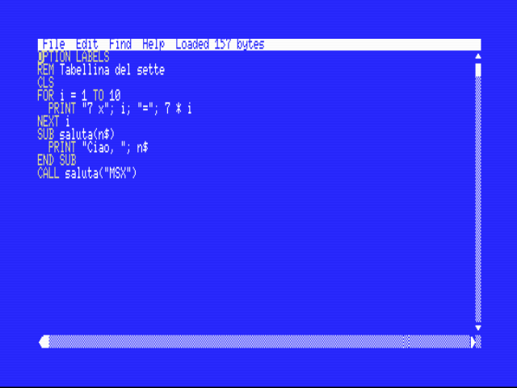

# SamPr Basic for MSX — VS Code extension

Work on **SamPr Basic** programs from VS Code with the same workflow, the same shortcuts and **the same files** as the editor that runs on the MSX: a project can be copied between a real machine (or an SD card / disk image) and the PC without any conversion.

SamPr Basic is a BASIC compiler and development environment for MSX (MSX1/MSX2, MSX-DOS 1/2) that produces real Z80 code. See the [main project](https://github.com/fpracek/MSX-SAMPRBASIC) and its manual.



## What you get

- **The real compiler, inside VS Code.** The extension runs the very same `QBC.COM` / `QBCR.COM` / `QBCB.COM` that run on the MSX, inside a small Z80 emulator with a simulated MSX-DOS. The output is the same as on the machine, in a few milliseconds.
- **Errors as you type** with the compiler's own messages, on the right file and line (also for unsaved text and for multi-file cartridges).
- **The same keys:** `F5` compile and run, `F6` help on the word under the cursor, `F7` help index, `F8` go to a segment.
- **The same look:** the *SamPr Basic MSX* color theme (white on blue, yellow keywords) and 80-column ruler.
- **Online help** for every statement and function, shown on hover and on `F6` / `F7`.
- **Outline** of `SUB`, `FUNCTION` and labels; snippets; syntax highlighting including `__ASM … __ENDASM` blocks.
- **Run in openMSX** for the three kinds of output: DOS programs (`.COM`), MSX-BASIC `.BIN` files and ROM cartridges.
- **Multi-file cartridges:** `NAME000.SPB`, `NAME001.SPB`… (5 characters + 3 digits) and precompiled `NAMEnnn.BIN` segments, exactly as on the MSX; `F8` saves the current file and jumps to another segment.

## Same files on the PC and on the MSX

| File | Meaning |
|---|---|
| `NAME.SPB` | SamPr Basic source (text, CR LF line ends; the extension sets this for `.spb` files) |
| `NAME.COM` | DOS program produced by the compiler |
| `NAME.BIN` | MSX-BASIC program (`CLEAR 200,&H83FF` then `BLOAD "NAME.BIN",R`) |
| `NAME.ROM` | ROM cartridge |
| `NAME000.SPB`, `NAME001.SPB`… `NAMEnnn.BIN` | segments of a multi-file cartridge |

Keep names within the MSX 8.3 limit. In the editor on the MSX, *Save As* accepts up to 8 characters and adds `.SPB`.

## Requirements

- [openMSX](https://openmsx.org) to run the programs (not needed to compile). Set `samprbasic.openmsx.path` if `openmsx` is not in your `PATH`.
- To run **DOS programs**: a folder with `MSXDOS.SYS` and `COMMAND.COM` (not included), set in `samprbasic.dosFiles`. The extension copies them next to your program, as on a real disk.

## Settings

| Setting | Meaning |
|---|---|
| `samprbasic.openmsx.path` | full path of `openmsx.exe` (empty = use `PATH`) |
| `samprbasic.dosFiles` | folder with `MSXDOS.SYS` and `COMMAND.COM` |
| `samprbasic.machine` | openMSX machine (default `Philips_NMS_8250`, MSX2, 80 columns) |
| `samprbasic.extension` | disk-interface extension for MSX1 machines (e.g. `Panasonic_FS-FD1A` with `Sony_HB-75P`) |
| `samprbasic.askDate` | type a date at the DOS prompt (MSX1 with MSX-DOS 1 asks for it) |
| `samprbasic.fullSpeedWhenLoading` | run openMSX at full speed during disk access |

## Commands

*SamPr Basic: Compile and Run* (`F5`), *Compile*, *Help on Word* (`F6`), *Help Index* (`F7`), *Go to Segment* (`F8`), *New Project from Sample*, *About*.

## Notes

- Not tried on real MSX hardware; the compiler and runtimes were tested on openMSX (Philips NMS 8250, Sony HB-75P, Panasonic FS-A1ST).
- Source-level debugging in openMSX is planned.

*SamPr Basic 1.0 — © 2026 Fausto Pracek.* This extension bundles the MIT-licensed [z80-emulator](https://github.com/lkesteloot/trs80) (see `THIRD-PARTY-NOTICES.txt`).

## Development

```
npm install
npm run data      # regenerates help.json, the grammar and the snippets from the project's documentation sources (needs Python)
npm run tools     # copies the compiler/runtime files from ../dist into tools/ (and the samples into samples/)
npm run build     # bundles src/ into dist/extension.js
npm test          # compile + run in openMSX (DOS, BIN, multi-file ROM) and the tests inside a real VS Code
npm run package   # builds the .vsix
```

`src/dos.ts` is the MSX-DOS host around the Z80 emulator, `src/compile.ts` drives the real compilers (including the chain `QBC.COM` → `QBCR.COM`/`QBCB.COM`), `src/openmsx.ts` launches openMSX and `src/extension.ts` holds the VS Code integration.
